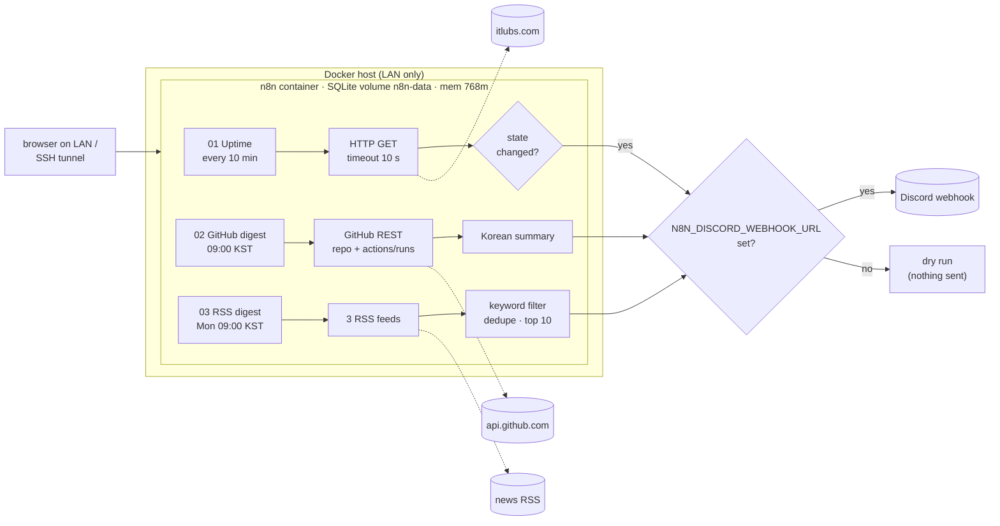

# n8n automation workflows

Three small, production-shaped [n8n](https://n8n.io) workflows plus the Docker Compose setup I run them on: a self-hosted, single-node n8n on a home-lab VM, bound to the LAN only.

세 가지 n8n 워크플로와, 이를 홈랩 VM(LAN 전용)에서 돌리는 Docker Compose 구성입니다. 한국어 설명은 [아래](#한국어)에 있습니다.

| # | Workflow | Trigger | What it does |
|---|----------|---------|--------------|
| 01 | `itlubs.com uptime + latency check` | every 10 min | `GET https://itlubs.com/` (10 s timeout), measures latency, alerts Discord on **state change** only: down (non-200 / timeout / network error), slow (> 5 s), recovered |
| 02 | `GitHub daily digest` | 09:00 KST daily | Public GitHub REST API (no token): stars + latest Actions run for 3 repos, Korean summary to Discord |
| 03 | `Weekly gaming-gear RSS digest` | Mon 09:00 KST | Reads TechPowerUp, Tom's Hardware and KitGuru RSS, keeps titles about mice/keyboards/headsets/monitors from the last 7 days, dedupes by normalised link, posts the 10 newest to Discord |

All three are exported **inactive** and contain **no credentials**. The Discord webhook is read at runtime from `$env.N8N_DISCORD_WEBHOOK_URL`. If it is empty, each workflow ends in a `Dry run - webhook not set` node instead of failing, so you can run them safely before wiring Discord.

## Architecture



## Design decisions

- **Alert on state change, not on every failed check.** Workflow 01 keeps `problem` / `since` in workflow static data. A 2-hour outage produces one "DOWN" message and one "RECOVERED" message, not twelve. (Static data is only persisted for trigger-started executions; manual runs always start from "ok".)
- **`neverError` + `continueRegularOutput` on outbound HTTP.** A timeout or 5xx becomes data the next node can inspect, instead of a crashed execution nobody sees.
- **Secrets via env, never in the JSON.** The webhook URL is `{{$env.N8N_DISCORD_WEBHOOK_URL}}`. n8n 2.x blocks `$env` in expressions by default; `N8N_BLOCK_ENV_ACCESS_IN_NODE=false` re-enables it. That is acceptable on a single-user instance; on a shared instance use an n8n credential instead.
- **Unauthenticated GitHub API.** 60 requests/hour per IP is plenty for 6 requests/day, and there is no token to leak. Add a fine-grained read-only token as an n8n credential if you track many repos.
- **Title-only keyword match for RSS.** Matching the article body pulled in unrelated stories (memory cards, VR accessories) that mention a peripheral in passing. Known limitation: "monitors" used as a verb in a title still matches.
- **Pinned image tag** (`n8nio/n8n:2.43.5`), not `latest`: upgrades are deliberate and can be rolled back.
- **SQLite in a named volume.** One user and a few workflows don't need Postgres; it also keeps memory use low on a small VM.

## Run it

```bash
cp .env.example .env && chmod 600 .env
sed -i "s/^N8N_ENCRYPTION_KEY=.*/N8N_ENCRYPTION_KEY=$(openssl rand -hex 32)/" .env
# optional: N8N_BIND_IP=<host LAN IP>   (default 127.0.0.1)
docker compose up -d
curl -s http://127.0.0.1:5678/healthz          # {"status":"ok"}
```

Open `http://<bind-ip>:5678` and create the owner account on first visit. With the default loopback bind, use a tunnel: `ssh -L 5678:127.0.0.1:5678 <host>`.

### Import the workflows

`compose.yaml` mounts `./workflows` read-only at `/workflows`:

```bash
for f in workflows/*.json; do docker compose exec -T n8n n8n import:workflow --input=/$f; done
docker compose exec -T n8n n8n list:workflow
```

Or use **Workflows → Import from file** in the UI. Imports are inactive; activate each one in the UI when you are ready.

### Set the Discord webhook

1. Discord: *Channel settings → Integrations → Webhooks → New webhook → Copy URL*.
2. Put it in `.env` as `N8N_DISCORD_WEBHOOK_URL=...`.
3. `docker compose up -d` (recreates the container with the new env; data stays in the volume).

### Run once from the CLI

Each workflow also has a `Run now (manual / CLI)` trigger, so it can be executed without activating it. The running server already holds the task-runner broker port, so give the CLI process another one:

```bash
docker compose exec -T -e N8N_RUNNERS_BROKER_PORT=5690 n8n n8n execute --id=uptimeItlubs0001 --rawOutput
```

### Validate

```bash
python3 scripts/validate_workflows.py   # nodes/connections exist, inactive, no secrets/IPs/paths
docker compose config --quiet
```

CI (`.github/workflows/validate.yml`) runs the same checks plus `jq` and gitleaks.

## Security notes

- **LAN/loopback only.** The port is published on one interface (`N8N_BIND_IP`, default `127.0.0.1`), never `0.0.0.0`. There is no reverse proxy and no TLS, so don't port-forward it to the internet.
- **`N8N_SECURE_COOKIE=false`.** Browsers drop `Secure` cookies over plain HTTP, which would make login impossible on `http://<lan-ip>:5678`. This is only acceptable because the instance is not reachable from outside. Put HTTPS in front (reverse proxy, Tailscale Serve) and set it back to `true` before exposing it any further.
- **`N8N_ENCRYPTION_KEY`** encrypts stored credentials. Keep `.env` at `chmod 600`, never commit it, and back the key up separately: if the volume survives but the key is lost, the credentials can't be decrypted.
- Diagnostics and personalization telemetry are disabled. The container has a 768 MB memory limit and rotated logs (3 × 10 MB). Execution data is pruned after 7 days.
- Discord messages set `allowed_mentions: { parse: [] }`, so RSS titles can't ping `@everyone`.

## What was verified

On a Debian 13 VM (2.5 GB RAM, Docker 29, Compose v5) with n8n 2.43.5:

- `/healthz` returned HTTP 200 on the LAN bind, and loopback was not bound.
- All three files imported with `n8n import:workflow`, and `n8n list:workflow` listed them.
- Each one was executed once with `n8n execute` and **no webhook set**:
  - 01: HTTP 200 → `State changed?` false → `No change - nothing to send`.
  - 02: 3 repos fetched → Korean summary built → dry run.
  - 03: 205 RSS items → filtered and deduped → top 10 → dry run.
- Not yet verified: delivery to a real Discord webhook and the alert path against a real outage. TODO: 측정 필요.

## Who did what

I set the requirements (what to monitor, LAN-only, no secrets in exports, dry-run without webhook), the security constraints and the deployment target. An AI coding agent wrote the compose file, workflow JSON and validator. They were checked by importing and executing them on the real n8n instance as described above.

---

## 한국어

홈랩 VM에 n8n을 자체 호스팅하고(LAN 전용, SQLite), 그 위에서 돌리는 실사용 워크플로 3개입니다.

- **01 사이트 가동/지연 체크 (10분마다):** `https://itlubs.com/`에 GET 요청을 보내 상태 코드와 응답 시간을 잽니다. 200이 아니거나 타임아웃·네트워크 오류면 "다운", 5초를 넘기면 "지연"으로 봅니다. 알림은 **상태가 바뀔 때만** 보냅니다(다운 → 알림, 복구 → 복구 알림). 그래서 장애가 길어져도 메시지가 쌓이지 않습니다.
- **02 GitHub 일일 요약 (매일 09:00 KST):** GitHub 공개 REST API를 토큰 없이 호출합니다. 저장소 3개의 스타 수와 최근 Actions 실행 결과를 모아 한국어 요약을 Discord로 보냅니다.
- **03 게이밍 기어 RSS 주간 요약 (월 09:00 KST):** TechPowerUp, Tom's Hardware, KitGuru RSS에서 최근 7일 기사 중 제목에 마우스·키보드·헤드셋·모니터가 들어간 것만 고릅니다. 링크 기준으로 중복을 없앤 뒤 최신 10개를 보냅니다.

### 사용법

1. `cp .env.example .env && chmod 600 .env`를 실행합니다. 그다음 `openssl rand -hex 32`로 만든 값을 `N8N_ENCRYPTION_KEY`에 넣습니다.
2. `docker compose up -d`로 띄웁니다. 처음 접속하면 브라우저에서 소유자 계정을 만듭니다.
3. 워크플로 가져오기: `for f in workflows/*.json; do docker compose exec -T n8n n8n import:workflow --input=/$f; done`
4. Discord 웹후크: 채널 설정 → 연동 → 웹후크에서 URL을 복사합니다. `.env`의 `N8N_DISCORD_WEBHOOK_URL`에 넣고 `docker compose up -d`를 다시 실행합니다. 값이 비어 있으면 모든 워크플로가 **드라이런**으로 끝나고 아무것도 보내지 않습니다.
5. 가져온 워크플로는 비활성 상태입니다. 확인한 뒤 UI에서 켜면 됩니다.

### 보안 메모

- 포트는 `N8N_BIND_IP` 인터페이스 하나에만 엽니다(기본값 127.0.0.1). TLS가 없으므로 인터넷에 포트포워딩하면 안 됩니다. 밖에서 접속하려면 SSH 터널이나 Tailscale을 쓰세요.
- `N8N_SECURE_COOKIE=false`: 평문 HTTP에서는 브라우저가 Secure 쿠키를 버려서 로그인이 안 됩니다. 외부에 노출하지 않는 LAN 환경이라서 허용한 설정입니다. HTTPS를 붙이면 다시 `true`로 바꾸세요.
- `N8N_ENCRYPTION_KEY`는 저장된 자격 증명을 암호화하는 키입니다. 잃어버리면 자격 증명을 복호화할 수 없습니다. 유출되면 복호화가 가능해집니다. `.env`는 600 권한으로 두고 커밋하지 마세요. 키는 따로 백업해 두세요.
- 워크플로 JSON에는 자격 증명, 웹후크 URL, 사설 IP가 들어가지 않습니다. CI의 `scripts/validate_workflows.py`와 gitleaks가 이를 검사합니다.

## License

MIT © lUbY
